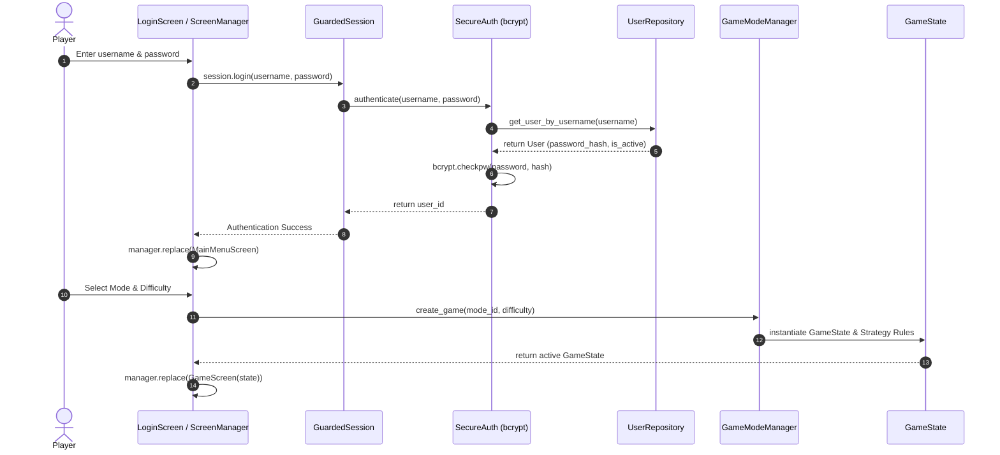
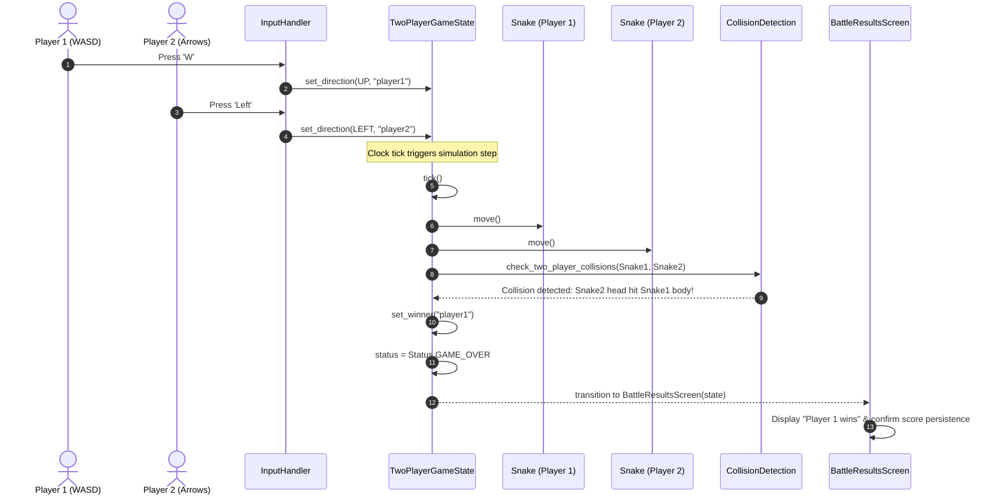
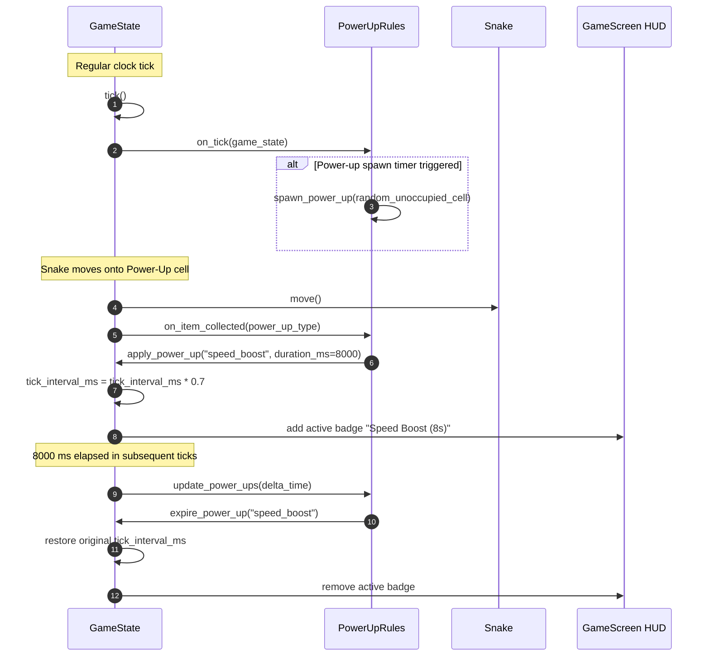
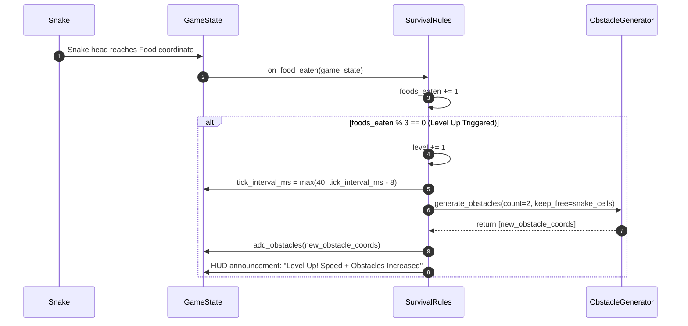
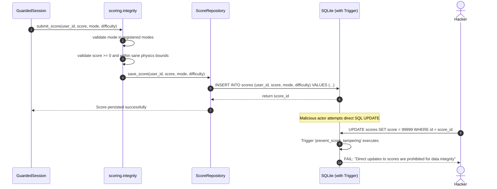
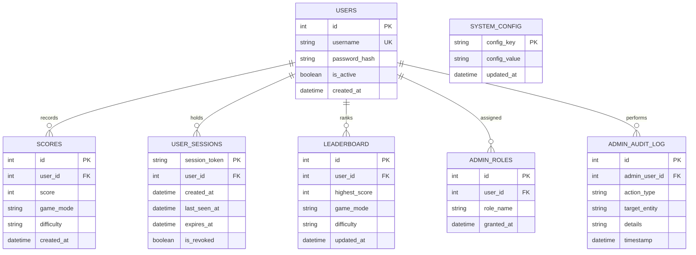

# Software Architecture and Design Specification (SAD)
## Project: A Snake Game
### A Modular Snake Game with Multiple Game Modes, Power-Ups, Survival Challenges, Multiplayer and Leaderboards

**Version:** 2.0 (Post-Sprint 2 Baseline)  
**Course:** Software Engineering  
**Date:** 11-11-2026  
**Team Number:** 6  
**Status:** Accepted / Verified  

---

## Authors & Responsibilities

| # | Name | SRN | Primary Responsibility |
|---|---|---|---|
| 1 | Thejaswi S | PES2UG24CS562 | Game Engine & Core Logic (state machine, $O(1)$ collision algorithms, food spawning) |
| 2 | Vishnu Maddirala | PES2UG24CS593 | Multiplayer & Communication (Two-Player battle architecture, dual input dispatch) |
| 3 | V S Shashidharan | PES2UG24CS568 | UI, Game Modes & Visualization (screen hierarchy, mode strategy implementations, HUD) |
| 4 | Vishwas Hosamath | PES2UG24CS596 | Scoring, Leaderboard, Security, QA & Testing (security architecture, admin subsystem, database extensions) |

---

## Revision History

| Version | Date | Author | Change Summary |
|---|---|---|---|
| 1.0 | 09-09-2026 | Team 6 | Initial draft architecture and design specification created from SRS v0.1. |
| 1.5 | 30-10-2026 | Team 6 | Sprint 1 Architecture: Pygame desktop launcher, SQLite repositories, Classic engine mode, basic authentication. |
| 2.0 | 11-11-2026 | Team 6 | Sprint 2 Final Architecture: Full five-mode strategy architecture (Obstacle, Power-Up, Two-Player, Survival), GuardedSession and SessionPolicy layer, dedicated AdminService with CLI and GUI screens, automated SQLite extension system (`ext_*.py`) with integrity triggers, $O(1)$ body collision bookkeeping, stochastic food generation, complete REST API endpoints, and sequence models. |

---

## Table of Contents

1. [Introduction & Architectural Goals](#1-introduction--architectural-goals)
2. [High-Level Architectural Overview](#2-high-level-architectural-overview)
3. [Component Architecture & Decomposition](#3-component-architecture--decomposition)
4. [Design Patterns & Principles](#4-design-patterns--principles)
5. [Detailed Dynamic Design (UML Sequence Diagrams)](#5-detailed-dynamic-design-uml-sequence-diagrams)
6. [Data Architecture & Relational Schema](#6-data-architecture--relational-schema)
7. [External & REST API Design](#7-external--rest-api-design)
8. [Cross-Cutting Concerns](#8-cross-cutting-concerns)
9. [Architectural Deviations & Rationale](#9-architectural-deviations--rationale)

---

## 1. Introduction & Architectural Goals

### 1.1 Purpose
This Software Architecture and Design Specification (SAD) documents the structural, behavioral, and operational architecture of **A Snake Game**. It provides the authoritative technical blueprint for component interfaces, design patterns, data schemas, and security controls realized in the Sprint 2 implementation.

### 1.2 Architectural Goals
* **Strict Modularity (Low Coupling, High Cohesion):** The simulation engine must operate completely headless without Pygame or GUI dependencies, enabling instant headless testing and simulation verification.
* **Extensibility:** New game modes, obstacles, and power-up modifiers must plug into the engine via polymorphic strategy hooks without altering core movement or clock routines.
* **Deterministic Simulation Performance:** Simulation ticks must consume $<3\mu\text{s}$ to guarantee sustained 60+ FPS rendering and instant input latching on low-spec hardware.
* **Security & Defense-in-Depth:** Password hashing via `bcrypt`, continuous role validation on every administrative call, database-level triggers enforcing score immutability, and dual-tier session timeouts.
* **Non-Invasive Database Extensibility:** Schema expansions must be modularly defined in independent extension files (`db/ext_*.py`) applied automatically on startup, eliminating brittle monolithic migration scripts.

---

## 2. High-Level Architectural Overview

A Snake Game uses a **layered, service-oriented architecture** comprising four primary tiers:
1. **Presentation Tier:** Pygame UI Screen Manager managing modal screen stacks, paired with an optional Flask HTTP web interface.
2. **Domain / Application Tier:** Game Mode strategies, Admin Service, Session Guard, and Statistics aggregators.
3. **Core Engine Tier:** Headless state machines (`GameState`, `TwoPlayerGameState`), collision evaluators, and spatial grid controllers.
4. **Data & Persistence Tier:** SQLite relational database wrapped with the Repository Pattern, schema extensions, and integrity triggers.

```mermaid
graph TB
    subgraph Presentation Tier
        Main[main.py Desktop Launcher] --> SM[ui.ScreenManager]
        SM --> Screens[UI Screens: Login, Menu, Game, Admin, Profile]
        Flask[run.py Flask Server] --> Routes[REST Blueprints: auth, scores, leaderboard]
    end

    subgraph Application & Security Tier
        GuardedSession[auth.GuardedSession]
        Policy[auth.SessionPolicy]
        AdminService[admin.AdminService]
        Stats[scoring.stats]
        Integrity[scoring.integrity]
    end

    subgraph Core Engine Tier
        ModeMgr[modes.GameModeManager]
        ModeMgr --> Rules[Mode Strategies: Classic, Obstacle, PowerUp, Survival, Battle]
        GameState[engine.GameState / TwoPlayerGameState]
        Snake[engine.Snake - O(1) Collision]
        Food[engine.Food - Stochastic Probe]
        Obstacles[engine.Obstacles - BFS Reachability]
    end

    subgraph Persistence Tier
        Repos[db Repositories: User, Score, Leaderboard, Admin]
        ExtLoader[db.extensions Loader]
        DB[(SQLite3 Database)]
        Triggers[Integrity Triggers]
    end

    Screens --> GuardedSession
    Screens --> GameState
    Routes --> Repos
    Routes --> Policy
    GuardedSession --> Policy
    GuardedSession --> Repos
    AdminService --> Repos
    GameState --> Snake
    GameState --> Food
    GameState --> Obstacles
    GameState --> Rules
    Repos --> ExtLoader
    ExtLoader --> DB
    DB --> Triggers
```

---

## 3. Component Architecture & Decomposition

### 3.1 Presentation Module (`ui/`)
* **`ScreenManager`:** Implements a state-driven screen stack (`push`, `pop`, `replace`), routing window events, rendering cycles, and tick updates to the active `Screen`.
* **Menu & Gameplay Screens:**
  * `LoginScreen` & `RegisterScreen`: Input field capture, error banner handling, and session initialization.
  * `MainMenuScreen`: Dynamic menu rendering, displaying administrative options only when `session.is_admin` is verified.
  * `ModeSelectionScreen` & `DifficultySelectionScreen`: Interactive mode and speed selection.
  * `GameScreen`: Renders the $30 \times 20$ grid, snake bodies with distinctive head accents, food items, static obstacles, animated power-up indicators, and the HUD.
  * `BattleResultsScreen`: Displays winner/draw outcome, dual-player final scores, and automated score persistence confirmation.
  * `ProfileScreen` & `SettingsScreen`: Displays statistical summaries and user preferences.
  * `AdminScreen`: Visual administrative dashboard for account management and system audits.

### 3.2 Game Engine Module (`engine/`)
* **`GameState`:** Central single-player state container encapsulating grid dimensions, tick rate, score, alive/dead state, and lifecycle hooks (`start`, `pause`, `resume`, `tick`).
* **`TwoPlayerGameState`:** Specialized dual-snake state container tracking independent directions, scores, body positions, and competitive win conditions.
* **`Snake`:** Directional multi-segment entity with an optimized $O(1)$ body collision structure:
  $$\text{Segments Frequency Map: } \text{Counter}((x, y))$$
  Entering a new cell increments its count; vacating a tail cell decrements or removes it. Self-collision lookup becomes an $O(1)$ dictionary key inspection.
* **`Food`:** Stochastic food generator utilizing 24 fast random probes before falling back to full grid scans, achieving microsecond spawn performance regardless of board area.
* **`Obstacles`:** Deterministic obstacle cluster generator with BFS flood-fill reachability validation ensuring no isolated dead zones exist.

### 3.3 Game Modes Subsystem (`modes/`)
* **`GameModeManager`:** Registry exposing the 5 supported modes: `classic`, `obstacle`, `power_up`, `two_player_battle`, `survival`.
* **`ModeRules` (Strategy Interface):**
  * `ClassicRules`: Default standard scoring and boundary collisions.
  * `ObstacleRules`: Generates static blocks on start and monitors obstacle collisions.
  * `PowerUpRules`: Spawns 5 temporary collectibles (`speed_boost`, `slow_down`, `shield`, `score_multiplier`, `snake_shrink`) and manages duration timers.
  * `SurvivalRules`: Escalating difficulty loop adding 8 ms velocity boost and 2 new obstacles every 3 foods eaten.
  * `TwoPlayerRules`: Synchronous dual-input updates and head-to-head collision resolution.

### 3.4 Authentication & Security Subsystem (`auth/`)
* **`SecureAuth`:** Cryptographic authentication service wrapping `bcrypt` for salted key generation (`bcrypt.hashpw`, `bcrypt.checkpw`).
* **`SessionPolicy`:** Central authority defining idle and absolute session lifespans:
  * Desktop GUI: 2-hour idle timeout, 12-hour absolute expiration.
  * Flask REST API: 30-minute idle timeout, 8-hour absolute expiration.
* **`GuardedSession`:** Transparent proxy wrapping the UI session. Intercepts game actions, verifies authentication and idle status, and automatically terminates expired sessions.

### 3.5 Administration Subsystem (`admin/`)
* **`AdminService`:** Core administrative business logic. Enforces authorization on **every single method invocation**:
  * `list_users(search, limit)`: Account search and status review.
  * `set_user_disabled(user_id, disabled, reason)`: Account suspension.
  * `delete_score(score_id)`: Fraudulent score removal with audit logging.
  * `set_config(key, value)`: Runtime speed and game configuration updates.
  * `check_data_integrity()` & `rebuild_leaderboard()`: Leaderboard consistency repair.
* **Admin CLI (`admin/__main__.py`):** Command-line tool for initial superuser creation (`make-admin`) and headless server maintenance.

### 3.6 Persistence & Schema Extension Subsystem (`db/`)
* **Repository Layer:** Clean query abstraction (`user_repository.py`, `score_repository.py`, `leaderboard_repository.py`, `admin_repository.py`).
* **Extension Mechanism (`db/extensions.py`):** Automatically discovers and executes `SQL` statements from all `ext_*.py` files:
  * `ext_sessions.py`: Creates `user_sessions` table with expiration timestamps.
  * `ext_admin.py`: Creates `admin_roles`, `admin_audit_log`, and `system_config` tables.
  * `ext_integrity.py`: Installs an SQLite `BEFORE UPDATE` trigger on the `scores` table:
    ```sql
    CREATE TRIGGER IF NOT EXISTS prevent_score_tampering
    BEFORE UPDATE ON scores
    BEGIN
        SELECT RAISE(FAIL, 'Direct updates to scores are prohibited for data integrity');
    END;
    ```

---

## 4. Design Patterns & Principles

1. **Strategy Pattern:** Implemented in `modes/rules.py`. `GameState` delegates mode-specific hooks (`on_start`, `on_tick`, `on_food_eaten`, `check_collision`) to interchangeable rule strategies without modifying engine mechanics.
2. **State Pattern:** Implemented in `ui/screen_manager.py`. Each UI screen (`MainMenuScreen`, `GameScreen`, `GameOverScreen`) is a distinct state handling its own events, updates, and rendering.
3. **Repository Pattern:** Separates database access details from business logic, ensuring SQL statements remain isolated within `db/` repositories.
4. **Proxy / Decorator Pattern:** `GuardedSession` wraps standard UI session objects, transparently enforcing session timeouts and authorization checks.
5. **Extension Loader (Micro-kernel architecture for schemas):** Discovers and applies schema extensions on startup without requiring database migration frameworks.

---

## 5. Detailed Dynamic Design (UML Sequence Diagrams)

### Flow 1: Player Authentication & Game Startup (Desktop Launcher)


### Flow 2: Two-Player Battle Mode Tick, Dual Input & Collision Resolution


### Flow 3: Power-Up Spawn, Collection, and Timed Expiration


### Flow 4: Survival Mode Progressive Scaling Loop


### Flow 5: Admin Authorization & Configuration Update
```mermaid
sequenceDiagram
    autonumber
    actor Admin
    participant AdminUI as AdminScreen / CLI
    participant Service as AdminService
    participant Repo as AdminRepository
    participant DB as SQLite Database

    Admin->>AdminUI: Request: Change Hard Speed to 60 ms
    AdminUI->>Service: set_config("difficulty.hard.speed_ms", 60)
    Note over Service: Authorization re-checked on EVERY call
    Service->>Repo: is_admin_session_valid(session_id)
    alt Unauthorized
        Repo-->>Service: False
        Service-->>AdminUI: Raise PermissionDeniedError
    else Authorized
        Repo-->>Service: True
        Service->>Repo: set_config_value("difficulty.hard.speed_ms", 60)
        Service->>Repo: record_audit_log(admin_id, "CONFIG_CHANGE", details)
        Repo->>DB: UPDATE system_config ...; INSERT INTO admin_audit_log ...;
        DB-->>Repo: Success
        Repo-->>Service: Done
        Service-->>AdminUI: Return updated configuration
    end
```

### Flow 6: Score Submission & Integrity Trigger Verification


---

## 6. Data Architecture & Relational Schema

### 6.1 Entity-Relationship Diagram (ERD)


---

## 7. External & REST API Design

The system provides an optional Flask REST API for backend integration and test automation.

| Endpoint | Method | Request Payload | Response Payload | Description |
|---|---|---|---|---|
| `/api/auth/register` | `POST` | `{"username": "str", "password": "str"}` | `{"status": "ok", "user_id": int}` | Registers a new account with bcrypt password hashing. |
| `/api/auth/login` | `POST` | `{"username": "str", "password": "str"}` | `{"token": "str", "user_id": int, "username": "str"}` | Authenticates credentials and returns a session token. |
| `/api/auth/logout` | `POST` | Header: `Authorization: Bearer <token>` | `{"status": "logged_out"}` | Revokes the current session token. |
| `/api/auth/logout-all` | `POST` | Header: `Authorization: Bearer <token>` | `{"status": "all_sessions_revoked"}` | Invalidates all active sessions for the user. |
| `/api/scores` | `POST` | `{"user_id": int, "score": int, "mode": "str", "difficulty": "str"}` | `{"status": "saved", "score_id": int}` | Validates and stores a completed game score. |
| `/api/leaderboard` | `GET` | Query: `?mode=classic&difficulty=medium&limit=10` | `[{"rank": 1, "username": "...", "score": 150}]` | Retrieves sorted personal-best scores. |

---

## 8. Cross-Cutting Concerns

### 8.1 Performance Optimization & Algorithms
* **$O(1)$ Self-Collision Checking:** Replacing linear body coordinate scanning with segment frequency counters reduced self-collision checks from $12.7\mu\text{s}$ to $0.4\mu\text{s}$ on a fully packed $30 \times 20$ board.
* **Fast Stochastic Food Spawning:** Probing 24 random cells before scanning open coordinates ensures food spawn time remains flat at $0.8\mu\text{s}$ even on large grids.
* **Deterministic Random Number Generation:** All procedural operations (food placement, obstacle clustering, power-up selection) accept injected `random.Random(seed)` instances, ensuring 100% reproducible test simulations.

### 8.2 Security Architecture & Authorization Enforcement
* **Continuous Authorization Re-Verification:** The `AdminService` never trusts cached role assertions from the UI. Every administrative method verifies whether the caller still holds an active, unexpired administrator session.
* **Defensive Score Triggers:** Database triggers reject SQL `UPDATE` operations on recorded scores, protecting against tampering.

---

## 9. Architectural Deviations & Rationale

1. **Dual Desktop GUI & REST Architecture:** SAD v1.0 initially contemplated either a desktop application or a browser-based client. Sprint 2 realized a unified hybrid approach: a native Pygame desktop client for lag-free local rendering paired with an optional Flask REST API, sharing the identical persistence and authentication libraries.
2. **Dynamic Extension Modules vs. Migration Engines:** Instead of introducing heavy database migration frameworks (e.g. Alembic), database extensions are modularized as self-contained SQL scripts in `db/ext_*.py` and executed dynamically via `db/extensions.py`. This enables independent feature branch development without schema merge collisions.
3. **Decoupled Game Engine from Pygame:** The engine simulation (`engine/`) was entirely decoupled from Pygame's video subsystem. This critical architectural decision allows the entire test suite and benchmarks to run in headless CI environments without graphics hardware.
