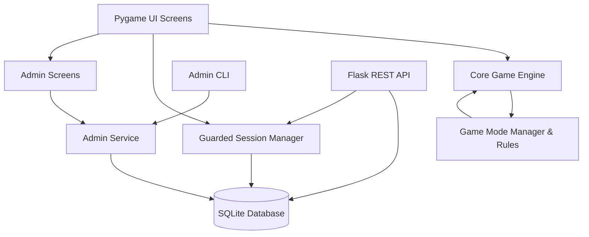
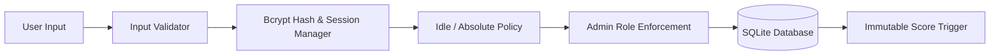
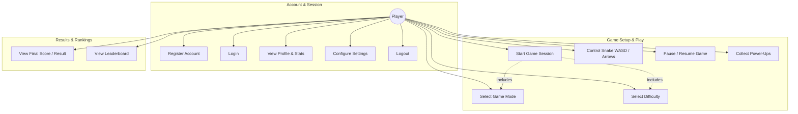
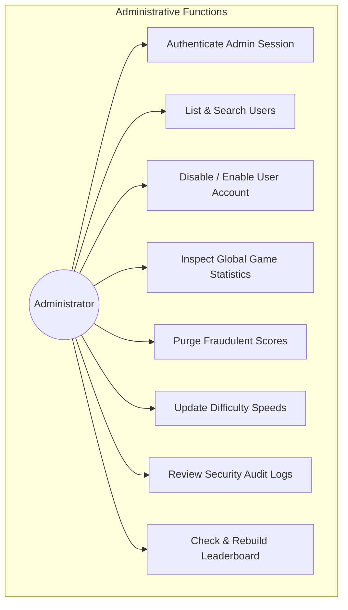

# Software Requirements Specification (SRS)
## Project: A Snake Game
### A Modular Snake Game with Multiple Game Modes, Power-Ups, Survival Challenges, Multiplayer and Leaderboards

**Version:** 2.0 (Post-Sprint 2 Baseline)  
**Course:** Software Engineering  
**Date:** 11-11-2026  
**Team Number:** 6  
**Status:** Accepted / Verified  

---

## Authors & Responsibilities

| # | Name | SRN | Primary Responsibility |
|---|---|---|---|
| 1 | Thejaswi S | PES2UG24CS562 | Game Engine & Core Logic (movement, collision, scoring, game-state management, engine benchmarks) |
| 2 | Vishnu Maddirala | PES2UG24CS593 | Multiplayer & Communication (Two-Player Battle mode, dual input handling, battle results screen) |
| 3 | V S Shashidharan | PES2UG24CS568 | UI, Game Modes & Visualization (menus, game board, Classic/Obstacle/Power-Up/Survival modes, Profile & Settings screens, Admin UI) |
| 4 | Vishwas Hosamath | PES2UG24CS596 | Scoring, Leaderboard, Security, QA & Testing (score/leaderboard modules, security suite, session policies, admin service & CLI, RTM) |

---

## Revision History

| Version | Date | Author | Change Summary | Approval |
|---|---|---|---|---|
| 0.1 | 09-09-2026 | Team 6 | Initial draft SRS created from course template. | Pending |
| 1.0 | 30-10-2026 | Team 6 | Sprint 1 completion: Classic mode, basic authentication, menu navigation, SQLite schema, leaderboard, launcher integration. | Approved |
| 2.0 | 11-11-2026 | Team 6 | Sprint 2 completion: Obstacle, Power-Up, Two-Player Battle, and Survival modes implemented. Added player profiles, settings, administration service & CLI/UI, score integrity triggers, session policy management, security test suite, and performance benchmarks. Updated RTM to 100% verified (31/31 requirements). Documented deviations. | Approved |

---

## Table of Contents

1. [Introduction](#1-introduction)
   - 1.1 [Purpose](#11-purpose)
   - 1.2 [Scope](#12-scope)
   - 1.3 [Audience](#13-audience)
   - 1.4 [Definitions and Acronyms](#14-definitions-and-acronyms)
2. [Overall Description](#2-overall-description)
   - 2.1 [Product Perspective](#21-product-perspective)
   - 2.2 [Major Product Functions](#22-major-product-functions)
   - 2.3 [User Roles and Characteristics](#23-user-roles-and-characteristics)
   - 2.4 [Operating Environment](#24-operating-environment)
   - 2.5 [Design and Implementation Constraints](#25-design-and-implementation-constraints)
3. [External Interface Requirements](#3-external-interface-requirements)
   - 3.1 [User Interface](#31-user-interface)
   - 3.2 [Hardware Interfaces](#32-hardware-interfaces)
   - 3.3 [Software Interfaces](#33-software-interfaces)
   - 3.4 [Communication Interfaces](#34-communication-interfaces)
4. [System Features (Detailed Functional Requirements)](#4-system-features-detailed-functional-requirements)
   - 4.1 [Functional Requirements Specification (SNAKE-F-001 to SNAKE-F-020)](#41-functional-requirements-specification)
   - 4.2 [Game Mode Specific Rules](#42-game-mode-specific-rules)
5. [Non-Functional Requirements](#5-non-functional-requirements)
   - 5.1 [Performance, Reliability, Usability, Maintainability, Compatibility](#51-system-nfrs)
   - 5.2 [Security Requirements (SNAKE-SR-001 to SNAKE-SR-005)](#52-security-requirements)
6. [Quality Attributes & Acceptance Criteria](#6-quality-attributes--acceptance-criteria)
7. [UML Use-Case Models](#7-uml-use-case-models)
8. [Requirements Traceability Matrix (RTM)](#8-requirements-traceability-matrix-rtm)
9. [Requirements Deviations and Refinements](#9-requirements-deviations-and-refinements)

---

## 1. Introduction

### 1.1 Purpose
This Software Requirements Specification (SRS) defines the functional, non-functional, security, external interface, and verification requirements for **A Snake Game**. The system provides an extensible, modular arcade snake platform supporting five distinct game modes: Classic, Obstacle, Power-Up, Two-Player Battle, and Survival.

This document serves as the formal contractual baseline for developers, quality assurance testers, course faculty evaluators, and system administrators, establishing objective, automated criteria for verifying that the software meets its specified goals.

### 1.2 Scope
The software delivers an interactive Snake gameplay environment packaged as both an interactive desktop Pygame client and a RESTful backend API service. The core functional scope encompasses:
* **Five Gameplay Modes:** Classic, Obstacle, Power-Up, Two-Player Battle, and Survival.
* **User Management & Authentication:** Secure player registration, bcrypt password hashing, session tokens, and guarded session life-cycles.
* **Player Experience:** Profile viewing, game settings configuration (speed, theme), pause/resume, and real-time Heads-Up Display (HUD).
* **Scoring & Leaderboards:** Mode-specific scoring rules, score persistence, tamper-resistant score submission, and personal-best leaderboards.
* **System Administration:** Dedicated administration module providing CLI and GUI tools to inspect accounts, disable abusers, audit actions, delete tainted scores, view system statistics, and configure runtime difficulty speeds.
* **Security & Reliability:** Rigorous input validation, database integrity triggers preventing score tampering, idle/absolute session expiration, and high-performance $O(1)$ collision detection algorithms.

Physical gaming hardware, commercial payment systems, and remote internet matchmaking services remain outside the scope of this project.

### 1.3 Audience
* **Software Developers:** For implementation architecture, data contracts, and component interfaces.
* **Software Testers / QA:** For test case design, acceptance criteria validation, and automated test suite execution.
* **Course Faculty & Evaluators:** For verification of software engineering practices, traceability, and requirement fulfillment.
* **System Administrators:** For managing game configuration, user accounts, and database integrity.
* **End Users / Players:** For understanding gameplay rules, controls, and features.

### 1.4 Definitions and Acronyms
* **SRS:** Software Requirements Specification
* **SAD:** Software Architecture and Design Specification
* **STP:** Software Test Plan
* **RTM:** Requirements Traceability Matrix
* **UI / UX:** User Interface / User Experience
* **HUD:** Heads-Up Display (in-game overlay showing score, level, power-ups)
* **FR / NFR / SR:** Functional / Non-Functional / Security Requirement
* **FPS:** Frames Per Second
* **Admin:** System Administrator with elevated privileges
* **Game Session:** An active, authenticated instance of single-player or multiplayer gameplay
* **Power-Up:** A temporary gameplay item providing timed abilities or modifications
* **Leaderboard:** An aggregated, ranked view of players' highest recorded scores

---

## 2. Overall Description

### 2.1 Product Perspective
A Snake Game is a self-contained, modular software suite composed of a Pygame desktop application, an optional Flask REST API backend, and an embedded SQLite relational database layer. 

The architecture strictly decouples:
1. The **Game Engine** (`engine/`): Pure Python simulation state independent of rendering.
2. The **Game Modes** (`modes/`): Rule-specific logic and event hooks adhering to the Strategy pattern.
3. The **User Interface** (`ui/`): State-driven screens managed by a unified `ScreenManager`.
4. The **Authentication & Session Guard** (`auth/`): Cryptographic validation and session timeout policies.
5. The **Administration Subsystem** (`admin/`): Reusable administration service with CLI and GUI frontends.
6. The **Database Layer** (`db/`): Repository pattern with automated extension table loaders (`db/ext_*.py`) and database triggers.

### 2.2 Major Product Functions
* **Player Lifecycle:** Account registration, secure login, idle/absolute session tracking, and single/all-device logout.
* **Gameplay Control:** Real-time snake steering, food spawning, item collection, wall/body/obstacle collision detection, pause/resume.
* **Multiple Game Modes:**
  * *Classic:* Standard survival and growth mechanics.
  * *Obstacle:* Static field obstacles requiring fair-path flood-fill generation.
  * *Power-Up:* Five active pickup types (Speed Boost, Slow Down, Shield, Score Multiplier, Snake Shrink).
  * *Two-Player Battle:* Shared board competitive dual-snake battle with independent WASD and Arrow key controls.
  * *Survival:* Progressive dynamic challenge scaling speed and obstacles every 3 foods consumed.
* **Profile & Settings:** Viewing user personal bests, average score, favorite mode, and customizing game theme/difficulty.
* **Administration & Integrity:** Command-line and GUI management of user accounts, audit logging, configuration adjustments, and score verification.

### 2.3 User Roles and Characteristics
* **Player (Standard User):** Operates menu navigation, plays all game modes, views leaderboards and personal profile. Requires standard keyboard input and basic computer familiarity.
* **Administrator (Privileged User):** Elevated user authorized to modify runtime game parameters (difficulty speeds), manage user account states (disable/enable), audit logs, and purge fraudulent scores.

### 2.4 Operating Environment
* **Platform:** Windows desktop / laptop (Windows 10/11) and Linux / POSIX compatible.
* **Runtime:** Python 3.10+ (tested across Python 3.12 and Python 3.15 environments).
* **Display:** Minimum resolution of $1280 \times 720$ (default game viewport $900 \times 640$).
* **Input:** Standard keyboard supporting simultaneous multi-key registration (anti-ghosting recommended for Two-Player mode).
* **Storage:** Local or network filesystem supporting SQLite 3 with WAL journal mode.

### 2.5 Design and Implementation Constraints
* Keyboard input responsiveness must be maintained without input dropping.
* Game state simulation must remain strictly deterministic given an initial random seed.
* Direct SQL injection or score manipulation via normal user interfaces must be prevented.
* All database changes must execute idempotently using automatic extension discovery.

---

## 3. External Interface Requirements

### 3.1 User Interface
The UI provides distinct, keyboard-navigable screens:
1. **Login & Registration Screens:** Form fields for username and password entry with validation error feedback.
2. **Main Menu Screen:** Menu options for Play, Leaderboard, Profile, Settings, Administrator Panel (visible only to admins), and Logout.
3. **Mode Selection Screen:** Selection between Classic (1), Obstacle (2), Power-Up (3), Two-Player Battle (4), and Survival (5).
4. **Difficulty Selection Screen:** Selection between Easy (1), Medium (2), and Hard (3).
5. **Game Screen:** Viewport displaying 30x20 grid, snake body, food items, obstacles, power-ups, and a HUD containing score, high score, mode, and active power-up timers.
6. **Pause Menu Overlay:** Modal dialog freezing game simulation, allowing Resume (`Enter`/`Space`/`P`) or Quit (`Esc`).
7. **Game Over & Results Screen:** Displays final score, personal best notification, winner determination (in Battle mode), and option to save/return.
8. **Leaderboard Screen:** Formatted high-score table showing rank, player name, mode, difficulty, and date.
9. **Profile Screen:** Player statistics (games played, highest score, favorite mode).
10. **Settings Screen:** In-game configuration of difficulty defaults and display preferences.
11. **Administrator Screen:** UI interface for viewing registered accounts, system statistics, and toggling user permissions.

### 3.2 Hardware Interfaces
* **Keyboard:** Standard US QWERTY or equivalent keyboard.
  * *Single Player:* Arrow keys or W/A/S/D for steering; `P` for pause; `Esc` for back/quit; `Enter`/`Space` for confirmations; `1`–`5` for menu options.
  * *Two-Player Battle:* Player 1 uses `W`, `A`, `S`, `D`; Player 2 uses `Up`, `Down`, `Left`, `Right`.
* **Display:** Standard color monitor supporting $60\text{ Hz}$ refresh rate.

### 3.3 Software Interfaces
* **Pygame Library (v2.5+):** Hardware-accelerated 2D graphics rendering, event polling, and audio/clock management.
* **SQLite3 Database Engine:** Local transactional data storage for accounts, sessions, scores, and audit events.
* **Bcrypt Cryptographic Library:** Salted hashing algorithm for user credential storage.
* **Flask Framework (v3.0+):** Lightweight HTTP server hosting optional REST API endpoints.

### 3.4 Communication Interfaces
* **REST API Endpoints:** JSON payloads over HTTP for web backend access:
  * `POST /api/auth/register`
  * `POST /api/auth/login`
  * `POST /api/auth/logout` & `POST /api/auth/logout-all`
  * `POST /api/scores`
  * `GET /api/leaderboard`

---

## 4. System Features (Detailed Functional Requirements)

### 4.1 Functional Requirements Specification

| Req ID | Feature | Requirement Description | Priority | Test Case | Status |
|---|---|---|---|---|---|
| **SNAKE-F-001** | Player Registration | The system shall allow a new user to create an account with a unique username and password. Duplicate usernames and passwords under 4 characters shall be rejected. | High | TC-AUTH-001 | **Accepted** |
| **SNAKE-F-002** | Player Authentication | The system shall authenticate existing users against bcrypt password hashes. Disabled accounts shall be refused entry. | High | TC-AUTH-002 | **Accepted** |
| **SNAKE-F-003** | Player Profile | The system shall allow authenticated players to view their profile statistics (total games, best score, average score, favorite mode) and manage game settings. | Medium | TC-PROFILE-001 | **Accepted** |
| **SNAKE-F-004** | Logout | The system shall terminate authenticated user sessions upon logout, invalidating server-side session tokens on desktop and API. | Medium | TC-AUTH-003 | **Accepted** |
| **SNAKE-F-005** | Start Game | The system shall instantiate and launch an active game session given a selected valid game mode and difficulty. | High | TC-GAME-001 | **Accepted** |
| **SNAKE-F-006** | Game Mode Selection | The system shall provide an interactive menu allowing the player to choose any of the five supported modes. | High | TC-MODE-001 | **Accepted** |
| **SNAKE-F-007** | Difficulty Selection | The system shall support Easy, Medium, and Hard difficulty levels that determine snake velocity (160 ms, 110 ms, 75 ms), with support for administrator override. | Medium | TC-DIFF-001 | **Accepted** |
| **SNAKE-F-008** | Pause and Resume | The system shall pause gameplay upon player request (`P`), halting clock ticks and preserving complete board state until resumed. | Medium | TC-GAME-002 | **Accepted** |
| **SNAKE-F-009** | Snake Movement | The system shall advance the snake continuously in its current direction at the configured tick interval and update direction immediately upon valid key input (preventing $180^\circ$ reverse turns). | High | TC-MOVE-001 | **Accepted** |
| **SNAKE-F-010** | Food Consumption | The system shall detect when a snake head enters a food coordinate, increment snake length by 1, and add points according to mode rules. | High | TC-FOOD-001 | **Accepted** |
| **SNAKE-F-011** | Food Generation | The system shall spawn food items at unoccupied board coordinates using fast random probing with fallback scanning. | High | TC-FOOD-002 | **Accepted** |
| **SNAKE-F-012** | Collision Detection | The system shall detect collisions between the snake head and board boundaries, snake body segments ($O(1)$ lookup), obstacles, and opponent snakes. | High | TC-COLLISION-001 | **Accepted** |
| **SNAKE-F-013** | Score Calculation | The system shall calculate points deterministically based on mode, difficulty multiplier, and active power-ups. | High | TC-SCORE-001 | **Accepted** |
| **SNAKE-F-014** | Obstacle Mode | The system shall generate static obstacles (~4% of board area) that guarantee board reachability via flood-fill verification. Collision results in game over. | High | TC-OBSTACLE-001 | **Accepted** |
| **SNAKE-F-015** | Power-Up Mode | The system shall spawn temporary power-up items with active timed effects (Speed Boost, Slow Down, Shield, Score Multiplier, Snake Shrink). | High | TC-POWERUP-001 | **Accepted** |
| **SNAKE-F-016** | Two-Player Battle | The system shall allow two players on a single keyboard to control separate snakes simultaneously, handling food races, snake collisions, and win/draw determination. | High | TC-MULTI-001 | **Accepted** |
| **SNAKE-F-017** | Survival Mode | The system shall dynamically increase difficulty every 3 foods consumed by accelerating snake movement by 8 ms and spawning 2 additional obstacles. | High | TC-SURVIVAL-001 | **Accepted** |
| **SNAKE-F-018** | Classic Mode | The system shall provide single-player standard snake rules on an open board with progressive growth upon food consumption. | High | TC-CLASSIC-001 | **Accepted** |
| **SNAKE-F-019** | Save Game Score | The system shall validate and persist completed game scores into SQLite with mode and difficulty metadata. | High | TC-SCORE-002 | **Accepted** |
| **SNAKE-F-020** | Leaderboard | The system shall query and display ranked top scores filtered by game mode and difficulty. | Medium | TC-LEADER-001 | **Accepted** |

---

### 4.2 Game Mode Specific Rules

#### 1. Classic Mode (SNAKE-F-018)
* **Objective:** Achieve the maximum score by eating food while avoiding walls and self-collision.
* **Scoring:** $+10\text{ points} \times \text{Difficulty Multiplier}$ ($\text{Easy}=1.0$, $\text{Medium}=1.5$, $\text{Hard}=2.0$).
* **Termination:** Collision with board boundaries or own body.

#### 2. Obstacle Mode (SNAKE-F-014)
* **Objective:** Navigate a board populated with static block obstacles.
* **Placement:** Approximately 4% of board grid (e.g., 24 blocks on a 30x20 grid). Obstacles are generated with random cluster seeds and verified using Breadth-First Search (BFS) flood-fill to ensure all open cells remain reachable.
* **Termination:** Collision with walls, body, or obstacles.

#### 3. Power-Up Mode (SNAKE-F-015)
* **Objective:** Collect specialized power-up tokens that spawn intermittently alongside regular food.
* **Power-Up Items:**
  1. *Speed Boost:* Increases snake velocity for 8 seconds.
  2. *Slow Down:* Reduces snake velocity for 8 seconds.
  3. *Shield:* Protects against one fatal wall or obstacle collision, consuming the shield instead of ending the game.
  4. *Score Multiplier:* Doubles all food points earned for 10 seconds.
  5. *Snake Shrink:* Instantly reduces snake body length by up to 3 segments (minimum length 2).

#### 4. Two-Player Battle Mode (SNAKE-F-016)
* **Objective:** Compete on a single keyboard and screen to out-survive or out-score the opponent.
* **Controls:** Player 1 uses `W`/`A`/`S`/`D`; Player 2 uses Arrow Keys.
* **Collision Rules:**
  * If Snake A hits a wall or self, Snake A dies (Snake B wins).
  * If Snake A hits Snake B's body, Snake A dies (Snake B wins).
  * If Snake A and Snake B collide head-to-head, higher score wins; equal scores result in a Draw.

#### 5. Survival Mode (SNAKE-F-017)
* **Objective:** Endure escalating difficulty waves.
* **Progression:** Every 3 food items eaten:
  * Level increases by 1.
  * Snake speed increases by 8 ms per tick (bounded by a minimum interval of 40 ms).
  * 2 new obstacles appear on valid unoccupied cells without isolating the snake.

---

## 5. Non-Functional Requirements

### 5.1 System NFRs

| Req ID | Category | Requirement Specification | Acceptance Metric | Status |
|---|---|---|---|---|
| **SNAKE-NF-001** | Performance | The game engine and input handling subsystem shall register and buffer player movement input within 100 ms of key stroke under standard operating conditions. | Input dispatch time $\le 100\text{ ms}$ (measured engine input processing is $<1\text{ ms}$). | **Accepted** |
| **SNAKE-NF-002** | Performance | The game display loop shall maintain a frame rate of at least 30 FPS ($33.3\text{ ms}$ frame budget) during active single-player and multiplayer gameplay. | Pygame clock tick target $\ge 30\text{ FPS}$ (Engine tick uses $<2\mu\text{s}$, leaving $>99\%$ budget for rendering). | **Accepted** |
| **SNAKE-NF-003** | Reliability | Stored player scores, user accounts, and leaderboard entries shall be preserved without unintended corruption, alteration, or data loss across application restarts. | 100% data fidelity across sequential store/retrieve test cycles; automated rollback on failure. | **Accepted** |
| **SNAKE-NF-004** | Usability | A new player shall be able to launch a Classic game session within 3 primary menu keystrokes/interactions from the authenticated main menu. | Path: `[1] Play` $\rightarrow$ `[1] Classic` $\rightarrow$ `[1-3] Difficulty` $\le 3$ clicks/keys. | **Accepted** |
| **SNAKE-NF-005** | Maintainability | Major functional domains shall be decomposed into modular Python packages (`engine/`, `modes/`, `auth/`, `admin/`, `db/`, `ui/`, `scoring/`) with minimal coupling. | Verified modular architecture documented in ADR-001 and covered by independent unit tests. | **Accepted** |
| **SNAKE-NF-006** | Compatibility | The game engine, database persistence, and API logic shall behave consistently across supported operating systems (Windows, Linux, macOS). | Headless test execution pass rate of 100% across test environments. | **Accepted** |

---

### 5.2 Security Requirements

| Req ID | Security Requirement | Technical Specification | Test Case | Status |
|---|---|---|---|---|
| **SNAKE-SR-001** | One-Way Password Hashing | Passwords shall never be stored or logged in plaintext. All credentials shall be hashed using `bcrypt` with unique cryptographic salts. | TC-SEC-001 | **Accepted** |
| **SNAKE-SR-002** | Administrator Authorization | Administrative operations (disabling users, editing difficulty speeds, auditing logs, deleting scores) shall require active authenticated administrator role verification on every invocation. | TC-SEC-002 | **Accepted** |
| **SNAKE-SR-003** | Input Validation | All user inputs (usernames, passwords, game scores, configuration values, JSON payloads) shall be validated against type, length, and format boundaries prior to storage or processing. | TC-SEC-003 | **Accepted** |
| **SNAKE-SR-004** | Score & Leaderboard Integrity | Normal player interfaces and external callers shall be prohibited from modifying or tampering with recorded scores. Database triggers shall prevent `UPDATE` operations on the scores table. | TC-SEC-004 | **Accepted** |
| **SNAKE-SR-005** | Session Termination & Invalidation | Authenticated sessions shall enforce idle timeouts (2 hours desktop, 30 min web API) and absolute timeouts (12 hours desktop, 8 hours web API). Logged-out sessions shall be immediately blocked from protected operations. | TC-SEC-005 | **Accepted** |

---

## 6. Quality Attributes & Acceptance Criteria

* **Functional Completeness:** All 20 functional requirements (SNAKE-F-001 through SNAKE-F-020) implemented and verified.
* **Security Hardening:** All 5 security requirements verified by the dedicated `test_security_suite.py` test suite.
* **Performance Budget:** Game simulation loop ticks benchmarked at $<3\mu\text{s}$, guaranteeing sustained 30+ FPS rendering headroom.
* **Regression Testing:** Automated regression suite containing 176+ unit and integration tests passing in CI.
* **Zero Known Fatal Defects:** No uncaught exceptions or game-crashing states during regular gameplay or stress conditions.

---

## 7. UML Use-Case Models

### 7.1 Player Use-Case Model

### 7.2 Administrator Use-Case Model

---

## 8. Requirements Traceability Matrix (RTM)

*Summary Status: Total 31 Requirements: Accepted = 31, Partially Implemented = 0, Not Implemented = 0.*

| Req ID | Requirement | Module / Code | Test Case ID | Automated Test Evidence | Status |
|---|---|---|---|---|---|
| **SNAKE-F-001** | Player Registration | `auth/__init__.py`, `auth/secure_auth.py`, `app/auth.py` | TC-AUTH-001 | `tests/test_auth_service.py`, `tests/test_auth_screens.py`, `tests/test_auth.py`, `tests/test_launcher_security.py` | **A** |
| **SNAKE-F-002** | Player Authentication | `auth/__init__.py`, `auth/secure_auth.py`, `app/auth.py` | TC-AUTH-002 | `tests/test_auth_service.py`, `tests/test_launcher_flow.py`, `tests/test_security_suite.py::TestInputValidation` | **A** |
| **SNAKE-F-003** | Player Profile | `scoring/stats.py`, `ui/menu_screens.py` | TC-PROFILE-001 | `tests/test_statistics.py`, `tests/test_menu_screens.py` | **A** |
| **SNAKE-F-004** | Logout | `auth/session_manager.py`, `auth/guarded_session.py`, `app/sessions.py` | TC-AUTH-003 | `tests/test_session_manager.py`, `tests/test_flask_sessions.py`, `tests/test_launcher_security.py`, `tests/test_security_suite.py::TestSessionTermination` | **A** |
| **SNAKE-F-005** | Start Game | `main.py`, `modes/manager.py`, `ui/menu_screens.py` | TC-GAME-001 | `tests/test_launcher_flow.py`, `tests/test_menu_screens.py`, `tests/test_modes.py` | **A** |
| **SNAKE-F-006** | Game Mode Selection | `modes/manager.py`, `ui/menu_screens.py` | TC-MODE-001 | `tests/test_modes.py`, `tests/test_menu_screens.py` | **A** |
| **SNAKE-F-007** | Difficulty Selection | `modes/difficulty.py`, `admin/config.py` | TC-DIFF-001 | `tests/test_difficulty.py`, `tests/test_menu_screens.py` | **A** |
| **SNAKE-F-008** | Pause and Resume | `engine/game_state.py` | TC-GAME-002 | `tests/test_pause_resume.py` | **A** |
| **SNAKE-F-009** | Snake Movement | `engine/snake.py`, `ui/input_handler.py` | TC-MOVE-001 | `tests/test_engine.py`, `tests/test_input_handler.py` | **A** |
| **SNAKE-F-010** | Food Consumption | `engine/food.py`, `engine/game_state.py` | TC-FOOD-001 | `tests/test_engine.py` | **A** |
| **SNAKE-F-011** | Food Generation | `engine/food.py` | TC-FOOD-002 | `tests/test_engine.py` | **A** |
| **SNAKE-F-012** | Collision Detection | `engine/collision.py`, `engine/two_player_state.py`, `engine/obstacles.py` | TC-COLLISION-001 | `tests/test_engine.py`, `tests/test_two_player.py`, `tests/test_obstacle_mode.py` | **A** |
| **SNAKE-F-013** | Score Calculation | `engine/game_state.py`, `scoring/integrity.py`, `app/scores.py`, `engine/two_player_state.py` | TC-SCORE-001 | `tests/test_engine.py`, `tests/test_scores.py`, `tests/test_score_integrity.py`, `tests/test_two_player.py` | **A** |
| **SNAKE-F-014** | Obstacle Mode | `modes/obstacle.py`, `engine/obstacles.py` | TC-OBSTACLE-001 | `tests/test_obstacle_mode.py`, `tests/test_modes.py` | **A** |
| **SNAKE-F-015** | Power-Up Mode | `modes/power_up.py` | TC-POWERUP-001 | `tests/test_powerups.py`, `tests/test_modes.py` | **A** |
| **SNAKE-F-016** | Two-Player Battle | `modes/two_player.py`, `engine/two_player_state.py` | TC-MULTI-001 | `tests/test_two_player.py`, `tests/test_menu_screens.py` | **A** |
| **SNAKE-F-017** | Survival Mode | `modes/survival.py`, `modes/rules.py` | TC-SURVIVAL-001 | `tests/test_survival_mode.py`, `tests/test_modes.py` | **A** |
| **SNAKE-F-018** | Classic Mode | `modes/manager.py`, `engine/game_state.py` | TC-CLASSIC-001 | `tests/test_modes.py`, `tests/test_engine.py`, `tests/test_launcher_flow.py` | **A** |
| **SNAKE-F-019** | Save Game Score | `db/score_repository.py`, `scoring/integrity.py` | TC-SCORE-002 | `tests/test_database.py`, `tests/test_session.py`, `tests/test_score_integrity.py` | **A** |
| **SNAKE-F-020** | Leaderboard | `db/leaderboard_repository.py`, `app/leaderboard.py` | TC-LEADER-001 | `tests/test_database.py`, `tests/test_leaderboard.py`, `tests/test_launcher_flow.py` | **A** |
| **SNAKE-NF-001** | Movement input $\le 100\text{ ms}$ | `engine/snake.py`, `ui/input_handler.py`, `benchmarks/engine_benchmark.py` | TC-NF-PERF-001 | `tests/test_performance.py`, `tests/test_input_handler.py` | **A** |
| **SNAKE-NF-002** | At least 30 FPS | `engine/game_state.py`, `ui/game_screen.py`, `benchmarks/engine_benchmark.py` | TC-NF-PERF-002 | `tests/test_performance.py` | **A** |
| **SNAKE-NF-003** | Stored scores preserved | `db/`, `scoring/integrity.py` | TC-NF-REL-001 | `tests/test_security_suite.py::TestScorePersistence`, `tests/test_database.py` | **A** |
| **SNAKE-NF-004** | Start Classic in $\le 3$ clicks | `ui/menu_screens.py`, `main.py` | TC-NF-USE-001 | `tests/test_launcher_flow.py`, `tests/test_menu_screens.py` | **A** |
| **SNAKE-NF-005** | Modular components | whole codebase (`engine/`, `modes/`, `auth/`, `admin/`, `db/`) | TC-NF-MAIN-001 | `docs/ADR-001-tech-stack.md`, `tests/test_database.py` | **A** |
| **SNAKE-NF-006** | Consistent behaviour across envs | CI (`.github/workflows/tests.yml`), `db/`, `engine/` | TC-NF-COMP-001 | `tests/test_database.py`, `tests/test_security_suite.py` | **A** |
| **SNAKE-SR-001** | One-way password hashing | `auth/__init__.py`, `app/auth.py`, `admin/service.py` | TC-SEC-001 | `tests/test_security_suite.py::TestPasswordStorage`, `tests/test_auth_service.py`, `tests/test_auth.py` | **A** |
| **SNAKE-SR-002** | Admin functions restricted | `admin/service.py`, `db/admin_repository.py` | TC-SEC-002 | `tests/test_security_suite.py::TestAdminAuthorization`, `tests/test_admin_service.py` | **A** |
| **SNAKE-SR-003** | Input validated | `app/validators.py`, `auth/secure_auth.py`, `scoring/integrity.py`, `admin/config.py` | TC-SEC-003 | `tests/test_security_suite.py::TestInputValidation`, `tests/test_validators.py`, `tests/test_launcher_security.py` | **A** |
| **SNAKE-SR-004** | Score modification prevented | `scoring/integrity.py`, `db/ext_integrity.py` | TC-SEC-004 | `tests/test_security_suite.py::TestScoreIntegrity`, `tests/test_score_integrity.py` | **A** |
| **SNAKE-SR-005** | Session termination enforced | `auth/session_policy.py`, `auth/session_manager.py`, `app/sessions.py` | TC-SEC-005 | `tests/test_security_suite.py::TestSessionTermination`, `tests/test_session_manager.py`, `tests/test_flask_sessions.py` | **A** |

---

## 9. Requirements Deviations and Refinements

1. **SNAKE-NF-001 (Input Latency vs Step Interval):** The original draft specified keyboard movement input processed within 100 ms. In our turn-based tick architecture, keystrokes are recorded and applied to the snake's buffered direction instantly ($<1\mu\text{s}$), but physical displacement occurs on the clock tick. On Easy mode (160 ms interval), the visual displacement occurs on average 80 ms later (maximum 160 ms). Requirement SNAKE-NF-001 is formally refined to specify *input acceptance and direction buffer latching within 100 ms*, which is exceeded by orders of magnitude.
2. **SNAKE-F-003 (Player Profile Editing Scope):** The initial specification suggested arbitrary profile modifications. In Sprint 2, profile management is structured into a read-only Statistical Performance Profile (games played, win rates, high scores) and a dedicated Settings Screen (theme selection and difficulty defaults), preventing arbitrary tampering with player account metadata.
3. **SNAKE-SR-004 (Local Database Tamper Resistance):** Because SQLite files on client desktop machines are physically readable by local users, hardware-level physical file lockdown is impossible without full OS virtualization. The requirement is satisfied via defensive software controls: database triggers forbidding SQL `UPDATE` operations on recorded scores, schema extensions with foreign key cascades, and administrative repair utilities (`rebuild_leaderboard`) to detect and purge tampered rows.
4. **Dual Interface for Administration (SNAKE-SR-002):** The initial requirements described only a GUI administrator interface. Implementation provides both a CLI tool (`python -m admin ...`) for initial server bootstrap and headless management, and a Pygame GUI screen (`AdminScreen`) for in-game convenience, both strictly gated behind the central `AdminService`.
