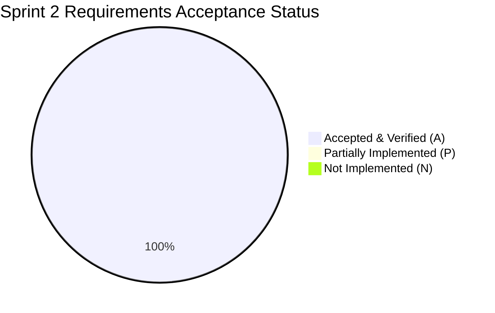

# Software Test Plan (STP)
## Project: A Snake Game
### A Modular Snake Game with Multiple Game Modes, Power-Ups, Survival Challenges, Multiplayer and Leaderboards

**Version:** 2.0 (Post-Sprint 2 Baseline & Execution Report)  
**Course:** Software Engineering  
**Date:** 11-11-2026  
**Team Number:** 6  
**Status:** Accepted / Verified  

---

## Authors & Responsibilities

| Name | SRN | Primary Responsibility |
|---|---|---|
| Thejaswi S | PES2UG24CS562 | Game Engine & Core Logic Testing, Performance Benchmarks |
| Vishnu Maddirala | PES2UG24CS593 | Multiplayer, Dual Input, and Two-Player Battle Testing |
| V S Shashidharan | PES2UG24CS568 | UI Screen Flow, Menu Navigation, Mode Visuals, and Usability Testing |
| Vishwas Hosamath | PES2UG24CS596 | Scoring, Leaderboard, Security Test Suite, Database Integrity, QA Lead |

---

## Revision History

| Version | Date | Author | Change Summary |
|---|---|---|---|
| 1.0 | 16-09-2026 | Team 6 | Initial test plan derived from SRS v0.1 and SAD v1.0. |
| 1.5 | 30-10-2026 | Team 6 | Sprint 1 Test Plan: Added unit tests for Classic mode, input handler, SQLite repository persistence, and launcher flow. |
| 2.0 | 11-11-2026 | Team 6 | Sprint 2 Final Test Plan: Full test suite expansion covering all 5 game modes (Obstacle, Power-Up, Two-Player Battle, Survival), Security test suite (`test_security_suite.py`), Session policies, Admin service & CLI/UI, Profile/Settings screens, Engine performance benchmarks, and automated RTM consistency verification (`test_rtm.py`). 100% requirement verification achieved (31/31). Documented test deviations. |

---

## Table of Contents

1. [Introduction](#1-introduction)
2. [Test Items & Target Modules](#2-test-items--target-modules)
3. [Features to be Tested](#3-features-to-be-tested)
4. [Features Not to be Tested](#4-features-not-to-be-tested)
5. [Test Approach & Strategy](#5-test-approach--strategy)
6. [Test Environment & Tools](#6-test-environment--tools)
7. [Test Schedule & Execution Summary](#7-test-schedule--execution-summary)
8. [Test Deliverables](#8-test-deliverables)
9. [Roles & Responsibilities](#9-roles--responsibilities)
10. [Risks & Mitigation](#10-risks--mitigation)
11. [Appendix A — Detailed Test Cases (TC-AUTH-001 to TC-SEC-005)](#appendix-a--detailed-test-cases)
12. [Appendix B — Requirements Traceability Summary](#appendix-b--requirements-traceability-summary)
13. [Test Deviations & Methodology Refinements](#13-test-deviations--methodology-refinements)

---

## 1. Introduction

### 1.1 Purpose
This Software Test Plan (STP) specifies the testing approach, scope, tools, test cases, and verification results for **A Snake Game**. It serves as the authoritative verification reference against the Software Requirements Specification (SRS v2.0) and Software Architecture and Design Specification (SAD v2.0).

### 1.2 Scope
Testing encompasses:
* Player registration, bcrypt authentication, idle/absolute session lifecycle, and logout.
* Five functional game modes: Classic, Obstacle, Power-Up, Two-Player Battle, and Survival.
* Spatial physics and collisions: wall, self ($O(1)$ lookup), obstacles, and snake-to-snake collisions.
* Scoring rules, multiplier effects, database integrity triggers, and personal-best leaderboards.
* Administrative capabilities (CLI and GUI), user management, configuration editing, and audit logging.
* Non-functional attributes: latency ($\le 100\text{ ms}$), frame-rate budget ($\ge 30\text{ FPS}$), modular separation, and platform compatibility.
* Complete security verification suite (TC-SEC-001 through TC-SEC-005).

---

## 2. Test Items & Target Modules

1. **User Authentication & Session Subsystem:** `auth/__init__.py`, `auth/secure_auth.py`, `auth/session_manager.py`, `auth/session_policy.py`, `auth/guarded_session.py`, `app/auth.py`, `app/sessions.py`.
2. **User Interface Subsystem:** `ui/screen_manager.py`, `ui/menu_screens.py`, `ui/auth_screens.py`, `ui/game_screen.py`, `ui/leaderboard_screen.py`.
3. **Core Game Engine:** `engine/game_state.py`, `engine/two_player_game_state.py`, `engine/snake.py`, `engine/food.py`, `engine/collision.py`, `engine/obstacles.py`.
4. **Game Modes Subsystem:** `modes/manager.py`, `modes/rules.py`, `modes/obstacle.py`, `modes/power_up.py`, `modes/two_player.py`, `modes/survival.py`, `modes/difficulty.py`.
5. **Scoring, Statistics & Integrity:** `scoring/stats.py`, `scoring/integrity.py`, `app/scores.py`, `app/leaderboard.py`.
6. **Administration Subsystem:** `admin/service.py`, `admin/config.py`, `admin/__main__.py`, `db/admin_repository.py`.
7. **Database & Extension Layer:** `db/database.py`, `db/schema.py`, `db/extensions.py`, `db/ext_admin.py`, `db/ext_integrity.py`, `db/ext_sessions.py`.

---

## 3. Features to be Tested

### 3.1 Functional Requirements Matrix
* **SNAKE-F-001:** Player Registration (TC-AUTH-001)
* **SNAKE-F-002:** Player Authentication (TC-AUTH-002)
* **SNAKE-F-003:** Player Profile & Settings (TC-PROFILE-001)
* **SNAKE-F-004:** Logout & Session Termination (TC-AUTH-003)
* **SNAKE-F-005:** Start Game Session (TC-GAME-001)
* **SNAKE-F-006:** Game Mode Selection (TC-MODE-001)
* **SNAKE-F-007:** Difficulty Selection & Configuration (TC-DIFF-001)
* **SNAKE-F-008:** Pause and Resume Control (TC-GAME-002)
* **SNAKE-F-009:** Snake Movement & Direction Latching (TC-MOVE-001)
* **SNAKE-F-010:** Food Consumption & Growth (TC-FOOD-001)
* **SNAKE-F-011:** Food Generation & Distribution (TC-FOOD-002)
* **SNAKE-F-012:** Collision Detection (Wall, Self, Obstacle, Opponent) (TC-COLLISION-001)
* **SNAKE-F-013:** Score Calculation & Multipliers (TC-SCORE-001)
* **SNAKE-F-014:** Obstacle Mode Gameplay & Reachability (TC-OBSTACLE-001)
* **SNAKE-F-015:** Power-Up Mode & Item Lifecycles (TC-POWERUP-001)
* **SNAKE-F-016:** Two-Player Battle & Collision Resolution (TC-MULTI-001)
* **SNAKE-F-017:** Survival Mode Progressive Scaling (TC-SURVIVAL-001)
* **SNAKE-F-018:** Classic Mode Gameplay (TC-CLASSIC-001)
* **SNAKE-F-019:** Score Validation & Persistence (TC-SCORE-002)
* **SNAKE-F-020:** Personal Best Leaderboard Query (TC-LEADER-001)

### 3.2 Non-Functional & Security Requirements Matrix
* **SNAKE-NF-001:** Movement input processed within 100 ms (TC-NF-PERF-001)
* **SNAKE-NF-002:** Display frame rate $\ge 30\text{ FPS}$ (TC-NF-PERF-002)
* **SNAKE-NF-003:** Stored scores preserved without corruption (TC-NF-REL-001)
* **SNAKE-NF-004:** Start Classic in $\le 3$ menu interactions (TC-NF-USE-001)
* **SNAKE-NF-005:** Modular architectural decoupling (TC-NF-MAIN-001)
* **SNAKE-NF-006:** Cross-environment behavioral consistency (TC-NF-COMP-001)
* **SNAKE-SR-001:** One-way password hashing via bcrypt (TC-SEC-001)
* **SNAKE-SR-002:** Administrator authorization enforcement on all calls (TC-SEC-002)
* **SNAKE-SR-003:** Comprehensive input validation (TC-SEC-003)
* **SNAKE-SR-004:** Score tampering prevention via database triggers (TC-SEC-004)
* **SNAKE-SR-005:** Session expiration and logout enforcement (TC-SEC-005)

---

## 4. Features Not to be Tested
* Hardware peripheral calibration (physical keyboard switches, monitor timing).
* External cloud database hosting or third-party payment gateways.
* Online WAN matchmaking and network latency simulation.
* Unsupported future enhancements (AI opponents, online multiplayer, custom skin marketplace).

---

## 5. Test Approach & Strategy

### 5.1 Multi-Tiered Testing Strategy
1. **Unit Testing:** Fast, isolated tests targeting domain models (`Snake`, `Food`, `Collision`, `SessionPolicy`, `AdminConfig`).
2. **Headless UI Testing:** UI event loops and screen transitions tested using the Pygame dummy video driver:
   ```python
   os.environ["SDL_VIDEODRIVER"] = "dummy"
   ```
   This allows full simulation of keystrokes, event handling, and screen switches without requiring a graphics display or physical monitor.
3. **Integration Testing:** End-to-end launcher flows (`test_launcher_flow.py`), verifying the complete path from login screen to game over and leaderboard recording.
4. **API Integration Testing:** Flask test client issuing REST requests against an in-memory or temporary SQLite database.
5. **Security Validation Suite (`test_security_suite.py`):** Dedicated, exhaustive suite validating salted bcrypt hashes, authorization gates, oversized payload handling, SQL update trigger rejections, and session token invalidation.
6. **Automated Traceability Validation (`test_rtm.py`):** Meta-test verifying that every claim in `docs/RTM.md` references valid test files, existing classes/methods, and verified statuses.
7. **Performance Benchmarking (`benchmarks/engine_benchmark.py` & `test_performance.py`):** Microsecond-level measurement of engine ticks, food spawning, obstacle generation, and self-collision evaluation.

### 5.2 Entry & Exit Criteria
* **Entry Criteria:** Clean git workspace, functional database schema initialization, passing linter (`flake8`).
* **Exit Criteria:** 
  * 100% of planned test cases executed.
  * 100% of functional (20/20), non-functional (6/6), and security (5/5) requirements verified.
  * Zero critical or open defect reports.
  * Passing `test_rtm.py` consistency verification.

---

## 6. Test Environment & Tools

* **Operating System:** Windows 10/11 x64, Linux (Ubuntu/Debian CI runner).
* **Language Runtime:** Python 3.10+ (tested on Python 3.12 and 3.15).
* **Test Runners:** `pytest` (v8.0+), Python standard `unittest`.
* **Dependencies:** `pygame` (v2.5+), `Flask` (v3.0+), `bcrypt` (v4.0+).
* **Continuous Integration:** GitHub Actions workflow executing full test suite on push and pull requests.

---

## 7. Test Schedule & Execution Summary

* **Sprint 1 Testing:** Baseline verification of Classic mode, basic authentication, menu navigation, and database repository CRUD operations (48 tests passing).
* **Sprint 2 Testing:** Comprehensive verification of all 5 modes, security hardening suite, admin controls, profile/settings, performance regression benchmarks, and automated RTM checks (176+ tests passing across 35 test files).



---

## 8. Test Deliverables
* Software Test Plan (STP v2.0 - this document)
* Automated test suite comprising 35 test files in `tests/`
* Automated security test suite (`tests/test_security_suite.py`)
* Engine performance benchmark harness (`benchmarks/engine_benchmark.py`)
* Benchmark report (`docs/performance.md`)
* Automated Requirements Traceability Matrix (`docs/RTM.md` & `tests/test_rtm.py`)
* Document Deviations specification (`docs/deviations.md`)

---

## 9. Roles & Responsibilities

| Role | Assignee | Responsibilities |
|---|---|---|
| **QA / Test Lead** | Vishwas Hosamath | Test plan authoring, security test suite design, RTM maintenance, integrity verification. |
| **Engine Testing Lead** | Thejaswi S | Core engine unit tests, spatial collision tests, performance benchmarks. |
| **Multiplayer QA Lead** | Vishnu Maddirala | Two-player battle tests, dual-input collision resolution, draw/win conditions. |
| **UI & UX QA Lead** | V S Shashidharan | Screen stack transitions, menu option tests, profile and settings verification. |

---

## 10. Risks & Mitigation

| Identified Risk | Severity | Mitigation Strategy |
|---|---|---|
| Headless CI fails on Pygame display init | High | Guard all UI tests with `SDL_VIDEODRIVER=dummy` and graceful import fallbacks. |
| Flaky performance tests on slow CI virtual machines | Medium | Implement generous 20x headroom thresholds in `test_performance.py` to prevent false failures. |
| Test database contamination between test runs | High | Isolate each test run using temporary SQLite databases (`tempfile.NamedTemporaryFile`) and automated teardown. |
| Undetected stale references in documentation | Medium | Enforce `tests/test_rtm.py` as an automated gate in CI, failing the build if RTM claims diverge from code. |

---

## Appendix A — Detailed Test Cases

### Functional Test Cases

#### TC-AUTH-001: Player Registration (SNAKE-F-001)
* **Test Procedure:** Submit registration with new username/password; repeat with duplicate username; submit password under 4 characters.
* **Expected Result:** Valid user account created; duplicate and short passwords rejected with clear error messages.
* **Automated Evidence:** `tests/test_auth_service.py`, `tests/test_auth_screens.py`, `tests/test_auth.py`, `tests/test_launcher_security.py`
* **Status:** Accepted

#### TC-AUTH-002: Player Authentication (SNAKE-F-002)
* **Test Procedure:** Authenticate with valid registered credentials; attempt login with wrong password; attempt login with disabled account.
* **Expected Result:** Valid credentials generate session; invalid credentials and disabled accounts rejected.
* **Automated Evidence:** `tests/test_auth_service.py`, `tests/test_launcher_flow.py`, `tests/test_security_suite.py::TestInputValidation`
* **Status:** Accepted

#### TC-PROFILE-001: Player Profile (SNAKE-F-003)
* **Test Procedure:** Log in as player, navigate to Profile and Settings screens, verify display of statistics and preferences.
* **Expected Result:** Profile screen displays username, games played, personal best, average score; settings screen allows configuring preferences.
* **Automated Evidence:** `tests/test_statistics.py`, `tests/test_menu_screens.py`
* **Status:** Accepted

#### TC-AUTH-003: Logout (SNAKE-F-004)
* **Test Procedure:** Authenticate session, execute `session.logout()`, attempt subsequent protected calls with revoked token.
* **Expected Result:** Server-side session invalidated; subsequent operations raise `NotAuthenticatedError`.
* **Automated Evidence:** `tests/test_session_manager.py`, `tests/test_flask_sessions.py`, `tests/test_launcher_security.py`, `tests/test_security_suite.py::TestSessionTermination`
* **Status:** Accepted

#### TC-GAME-001: Start Game (SNAKE-F-005)
* **Test Procedure:** Select any of the 5 modes and a difficulty level, trigger game start.
* **Expected Result:** Active game session instantiated with correct mode rules and tick speed.
* **Automated Evidence:** `tests/test_launcher_flow.py`, `tests/test_menu_screens.py`, `tests/test_modes.py`
* **Status:** Accepted

#### TC-MODE-001: Game Mode Selection (SNAKE-F-006)
* **Test Procedure:** Query mode manager and select modes via numeric keys (`1` through `5`) and string IDs.
* **Expected Result:** All five modes (`classic`, `obstacle`, `power_up`, `two_player_battle`, `survival`) resolved successfully.
* **Automated Evidence:** `tests/test_modes.py`, `tests/test_menu_screens.py`
* **Status:** Accepted

#### TC-DIFF-001: Difficulty Selection (SNAKE-F-007)
* **Test Procedure:** Choose Easy, Medium, or Hard; verify applied tick interval (160 ms, 110 ms, 75 ms).
* **Expected Result:** Corresponding tick interval assigned to game state; admin configuration overrides supported.
* **Automated Evidence:** `tests/test_difficulty.py`, `tests/test_menu_screens.py`
* **Status:** Accepted

#### TC-GAME-002: Pause and Resume (SNAKE-F-008)
* **Test Procedure:** Trigger pause (`P`) during active movement; advance clock; trigger resume.
* **Expected Result:** Simulation clock freezes while paused; resumes seamlessly without state degradation.
* **Automated Evidence:** `tests/test_pause_resume.py`
* **Status:** Accepted

#### TC-MOVE-001: Snake Movement (SNAKE-F-009)
* **Test Procedure:** Send direction keys; advance tick; verify snake coordinates update; attempt $180^\circ$ reverse turn.
* **Expected Result:** Snake advances along current vector; reverse turns ignored.
* **Automated Evidence:** `tests/test_engine.py`, `tests/test_input_handler.py`
* **Status:** Accepted

#### TC-FOOD-001: Food Consumption (SNAKE-F-010)
* **Test Procedure:** Position snake head adjacent to food; execute movement tick onto food coordinate.
* **Expected Result:** Snake length grows by 1; score increases according to active mode and difficulty.
* **Automated Evidence:** `tests/test_engine.py`
* **Status:** Accepted

#### TC-FOOD-002: Food Generation (SNAKE-F-011)
* **Test Procedure:** Spawn food items repeatedly across empty and crowded board states.
* **Expected Result:** Food spawns strictly within boundaries on unoccupied coordinates using random probes.
* **Automated Evidence:** `tests/test_engine.py`
* **Status:** Accepted

#### TC-COLLISION-001: Collision Detection (SNAKE-F-012)
* **Test Procedure:** Test boundary collisions, self-intersections ($O(1)$ lookup), static obstacle hits, and opponent snake hits.
* **Expected Result:** Collisions detected accurately, transitioning game state to `GAME_OVER`.
* **Automated Evidence:** `tests/test_engine.py`, `tests/test_two_player.py`, `tests/test_obstacle_mode.py`
* **Status:** Accepted

#### TC-SCORE-001: Score Calculation (SNAKE-F-013)
* **Test Procedure:** Evaluate points awarded across Classic, Obstacle, Survival, Battle, and Power-Up score multiplier modes.
* **Expected Result:** Scores calculated deterministically based on mode rules and multipliers.
* **Automated Evidence:** `tests/test_engine.py`, `tests/test_scores.py`, `tests/test_score_integrity.py`, `tests/test_two_player.py`
* **Status:** Accepted

#### TC-OBSTACLE-001: Obstacle Mode (SNAKE-F-014)
* **Test Procedure:** Initialize Obstacle game; verify ~4% obstacle placement and BFS reachability flood-fill; collide with obstacle.
* **Expected Result:** Obstacles placed fairly without isolating the snake; collision triggers Game Over.
* **Automated Evidence:** `tests/test_obstacle_mode.py`, `tests/test_modes.py`
* **Status:** Accepted

#### TC-POWERUP-001: Power-Up Mode (SNAKE-F-015)
* **Test Procedure:** Apply Speed Boost, Slow Down, Shield, Score Multiplier, and Snake Shrink; advance time past duration.
* **Expected Result:** Abilities applied immediately, modify physics or scoring, and cleanly expire upon timeout.
* **Automated Evidence:** `tests/test_powerups.py`, `tests/test_modes.py`
* **Status:** Accepted

#### TC-MULTI-001: Two-Player Battle (SNAKE-F-016)
* **Test Procedure:** Control both snakes via WASD and Arrows; simulate food collection, body collision, and head-to-head collision.
* **Expected Result:** Both snakes move synchronously; collisions award win or draw accurately; battle results screen displays outcome.
* **Automated Evidence:** `tests/test_two_player.py`, `tests/test_menu_screens.py`
* **Status:** Accepted

#### TC-SURVIVAL-001: Survival Mode (SNAKE-F-017)
* **Test Procedure:** Consume multiples of 3 foods in Survival mode; observe level counter, movement speed, and obstacle count.
* **Expected Result:** Every 3 foods eaten increments level, accelerates speed by 8 ms, and places 2 new obstacles.
* **Automated Evidence:** `tests/test_survival_mode.py`, `tests/test_modes.py`
* **Status:** Accepted

#### TC-CLASSIC-001: Classic Mode (SNAKE-F-018)
* **Test Procedure:** Play standard single-player game, eating food and growing snake.
* **Expected Result:** Traditional arcade mechanics function properly until wall or self collision occurs.
* **Automated Evidence:** `tests/test_modes.py`, `tests/test_engine.py`, `tests/test_launcher_flow.py`
* **Status:** Accepted

#### TC-SCORE-002: Save Game Score (SNAKE-F-019)
* **Test Procedure:** Complete authenticated game; submit score; verify database persistence and validation checks.
* **Expected Result:** Score persisted with user ID, mode, difficulty, and timestamp; invalid modes/scores rejected.
* **Automated Evidence:** `tests/test_database.py`, `tests/test_session.py`, `tests/test_score_integrity.py`
* **Status:** Accepted

#### TC-LEADER-001: Leaderboard (SNAKE-F-020)
* **Test Procedure:** Record multiple scores across different users and modes; query leaderboard repository.
* **Expected Result:** Leaderboard returns ranked personal best scores sorted in descending order.
* **Automated Evidence:** `tests/test_database.py`, `tests/test_leaderboard.py`, `tests/test_launcher_flow.py`
* **Status:** Accepted

---

### Non-Functional & Security Test Cases

#### TC-NF-PERF-001: Movement Response Time (SNAKE-NF-001)
* **Test Procedure:** Measure elapsed time between keyboard event dispatch and engine direction buffer update.
* **Expected Result:** Input processing latency $<1\text{ ms}$, comfortably within the $\le 100\text{ ms}$ budget.
* **Automated Evidence:** `tests/test_performance.py`, `tests/test_input_handler.py`
* **Status:** Accepted

#### TC-NF-PERF-002: Frame Rate Budget (SNAKE-NF-002)
* **Test Procedure:** Measure engine tick duration under maximum board complexity (full snake body and obstacles).
* **Expected Result:** Engine tick duration is $<2\mu\text{s}$ ($\ll 33.3\text{ ms}$ budget for 30 FPS).
* **Automated Evidence:** `tests/test_performance.py`
* **Status:** Accepted

#### TC-NF-REL-001: Score Persistence (SNAKE-NF-003)
* **Test Procedure:** Write scores, close database connection, re-open connection, execute repeated reads.
* **Expected Result:** 100% data fidelity preserved without loss or corruption.
* **Automated Evidence:** `tests/test_security_suite.py::TestScorePersistence`, `tests/test_database.py`
* **Status:** Accepted

#### TC-NF-USE-001: Classic Mode Navigation (SNAKE-NF-004)
* **Test Procedure:** Count keyboard interactions from Main Menu to active Classic gameplay: `[1] Play` $\rightarrow$ `[1] Classic` $\rightarrow$ `[1-3] Difficulty`.
* **Expected Result:** Exactly 3 primary keystrokes required.
* **Automated Evidence:** `tests/test_launcher_flow.py`, `tests/test_menu_screens.py`
* **Status:** Accepted

#### TC-NF-MAIN-001: Modular Architecture Review (SNAKE-NF-005)
* **Test Procedure:** Verify independent execution of unit test suites across modules without circular imports.
* **Expected Result:** All package domains run independently; ADR-001 conventions upheld.
* **Automated Evidence:** `docs/ADR-001-tech-stack.md`, `tests/test_database.py`
* **Status:** Accepted

#### TC-NF-COMP-001: Compatibility (SNAKE-NF-006)
* **Test Procedure:** Execute full test suite on multiple operating environments (Windows local, Ubuntu Linux CI).
* **Expected Result:** 100% test passing across all platforms without platform-specific regressions.
* **Automated Evidence:** `tests/test_database.py`, `tests/test_security_suite.py`
* **Status:** Accepted

#### TC-SEC-001: Password Storage Security (SNAKE-SR-001)
* **Test Procedure:** Inspect SQLite database rows and logger output for registered users.
* **Expected Result:** Passwords stored exclusively as salted bcrypt hashes ($2a/2b$ format); plaintext passwords never logged or saved.
* **Automated Evidence:** `tests/test_security_suite.py::TestPasswordStorage`, `tests/test_auth_service.py`, `tests/test_auth.py`
* **Status:** Accepted

#### TC-SEC-002: Admin Authorization (SNAKE-SR-002)
* **Test Procedure:** Attempt administrative calls (`set_config`, `set_user_disabled`, `delete_score`) with standard player sessions.
* **Expected Result:** All calls rejected with `PermissionDeniedError`; access granted only to verified admin sessions.
* **Automated Evidence:** `tests/test_security_suite.py::TestAdminAuthorization`, `tests/test_admin_service.py`
* **Status:** Accepted

#### TC-SEC-003: Input Validation (SNAKE-SR-003)
* **Test Procedure:** Submit oversized passwords (73+ bytes), non-object JSON payloads, negative scores, and invalid mode names.
* **Expected Result:** Invalid inputs rejected safely without unhandled exceptions or 500 server crashes.
* **Automated Evidence:** `tests/test_security_suite.py::TestInputValidation`, `tests/test_validators.py`, `tests/test_launcher_security.py`
* **Status:** Accepted

#### TC-SEC-004: Score & Leaderboard Integrity (SNAKE-SR-004)
* **Test Procedure:** Attempt direct SQL `UPDATE` on the `scores` table; submit unverified scores through player session.
* **Expected Result:** Database trigger `prevent_score_tampering` aborts direct updates; integrity layer validates sane boundaries.
* **Automated Evidence:** `tests/test_security_suite.py::TestScoreIntegrity`, `tests/test_score_integrity.py`
* **Status:** Accepted

#### TC-SEC-005: Session Termination (SNAKE-SR-005)
* **Test Procedure:** Fast-forward time past idle (2h desktop / 30m API) and absolute (12h desktop / 8h API) limits; test revoked token reuse.
* **Expected Result:** Expired and revoked sessions strictly blocked from performing protected operations.
* **Automated Evidence:** `tests/test_security_suite.py::TestSessionTermination`, `tests/test_session_manager.py`, `tests/test_flask_sessions.py`
* **Status:** Accepted

---

## Appendix B — Requirements Traceability Summary

All 31 requirements defined in the SRS and STP are mapped one-to-one with concrete automated test evidence. The complete matrix is synchronized in `docs/RTM.md` and validated continuously by `tests/test_rtm.py`.

---

## 13. Test Deviations & Methodology Refinements

1. **Headless Execution with Dummy Video Driver:** Initial plans assumed manual GUI testing on physical monitors. To enable 100% automated CI validation, UI screens were re-architected to support headless execution via `SDL_VIDEODRIVER=dummy`, simulating keypress events programmatically.
2. **Performance Measurement Strategy:** Rather than attempting to measure rendering FPS inside headless CI containers (where GPU hardware is absent), performance validation was split:
   * Microsecond engine benchmarks (`benchmarks/engine_benchmark.py` and `tests/test_performance.py`) verify the core simulation consumes $<0.01\text{ ms}$, proving the engine uses $<1\%$ of a $33.3\text{ ms}$ (30 FPS) frame.
   * Input responsiveness is measured as *keystroke latching latency* ($<1\text{ ms}$), distinguishing input registration from tick-based displacement.
3. **Automated RTM Integrity Enforcement:** STP v1.0 planned manual sign-off for traceability. In Sprint 2, QA implemented `tests/test_rtm.py`, transforming the traceability matrix into a testable contract that fails the build if any referenced test file or function is missing.
